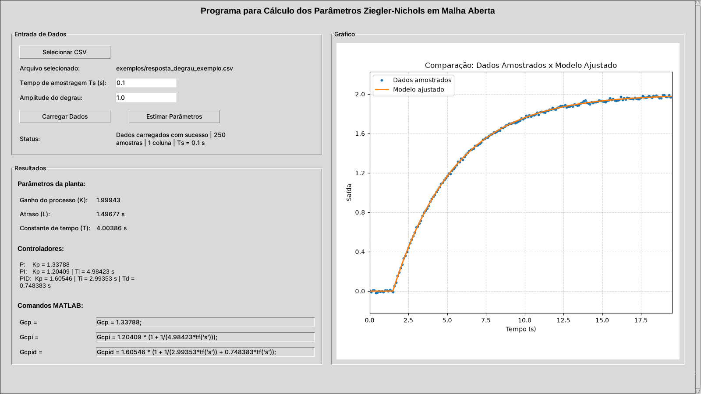

# ZN_Controller

Aplicativo desktop em Python para **sintonia de controladores P, PI e PID pelo método de Ziegler-Nichols em malha aberta**, a partir da resposta ao degrau medida de uma planta.

Você carrega um CSV com a saída amostrada do processo, o programa identifica um modelo de **primeira ordem com atraso (FOPDT)**, calcula os ganhos dos controladores e já entrega os comandos prontos para colar no **MATLAB**.



## Funcionalidades

- Leitura de CSV com a resposta ao degrau (aceita decimal com vírgula ou ponto)
- Gráfico dos dados amostrados
- Identificação automática de **K** (ganho), **L** (atraso) e **T** (constante de tempo) por ajuste de curva não linear (`scipy.optimize.curve_fit`)
- Gráfico comparando dados medidos × modelo ajustado, para validar a identificação
- Cálculo dos parâmetros P, PI e PID pelas regras de Ziegler-Nichols
- Geração das funções de transferência dos controladores em sintaxe MATLAB (`tf('s')`)
- Executável para Windows, sem precisar instalar Python

## Como funciona

### 1. Identificação da planta (modelo FOPDT)

A resposta ao degrau é aproximada por:

$$
G(s) = \frac{K\,e^{-Ls}}{Ts + 1}
\qquad\Rightarrow\qquad
y(t) =
\begin{cases}
0, & t < L \\
K\,\Delta u\left(1 - e^{-(t-L)/T}\right), & t \ge L
\end{cases}
$$

onde $\Delta u$ é a amplitude do degrau aplicado. Os parâmetros $K$, $L$ e $T$ são obtidos por mínimos quadrados sobre os dados medidos.

### 2. Sintonia de Ziegler-Nichols (malha aberta)

| Controlador | $K_p$ | $T_i$ | $T_d$ |
|---|---|---|---|
| P   | $\dfrac{T}{K L}$       | —        | —        |
| PI  | $0{,}9\,\dfrac{T}{K L}$ | $3{,}33\,L$ | —        |
| PID | $1{,}2\,\dfrac{T}{K L}$ | $2\,L$   | $0{,}5\,L$ |

### 3. Saída para o MATLAB

Os controladores são escritos na forma ideal $G_c(s) = K_p\left(1 + \frac{1}{T_i s} + T_d s\right)$:

```matlab
Gcp   = 1.33788;
Gcpi  = 1.20409 * (1 + 1/(4.98423*tf('s')));
Gcpid = 1.60546 * (1 + 1/(2.99353*tf('s')) + 0.748383*tf('s'));
```

## Formato do arquivo CSV

- **Uma única coluna** com os valores da saída da planta, uma amostra por linha
- Sem cabeçalho
- Separador `;` (o arquivo de uma coluna funciona normalmente)
- Decimal com `.` ou `,`
- As amostras devem ser igualmente espaçadas; o período **Ts** é informado na interface
- A primeira amostra corresponde ao instante em que o degrau é aplicado (t = 0), com a saída partindo de zero

Exemplo (`exemplos/resposta_degrau_exemplo.csv`):

```
0.0030
-0.0104
0.0075
...
```

## Como usar

### Opção 1 — Executável (Windows)

Baixe o `ZN_Controller.exe` na página de [**Releases**](../../releases/latest) e execute. Não é necessário ter Python instalado.

### Opção 2 — Rodando pelo código-fonte

Requer Python 3.10+ com Tkinter (já incluso no instalador oficial do Python para Windows).

```bash
git clone https://github.com/FALima8/ZN_Controller.git
cd ZN_Controller
pip install -r requirements.txt
python ZN_Controller.py
```

### Passo a passo na interface

1. Clique em **Selecionar CSV** e escolha o arquivo com a resposta ao degrau
2. Informe o **tempo de amostragem Ts** (em segundos) e a **amplitude do degrau**
3. Clique em **Carregar Dados** — o gráfico com os pontos medidos aparece à direita
4. Clique em **Estimar Parâmetros** — o programa mostra K, L, T, os ganhos P/PI/PID e os comandos MATLAB
5. Clique em um campo de comando MATLAB para selecioná-lo e copie com `Ctrl+C`

Para testar rapidamente, use `exemplos/resposta_degrau_exemplo.csv` com **Ts = 0.1** e **degrau = 1.0**. O arquivo foi gerado a partir de uma planta com K = 2, L = 1,5 s e T = 4 s (com ruído), e o programa recupera esses valores.

## Gerando o executável

O `.exe` foi gerado com [PyInstaller](https://pyinstaller.org/):

```bash
pip install pyinstaller
pyinstaller --onefile --windowed ZN_Controller.py
```

O executável fica em `dist/ZN_Controller.exe`.

## Estrutura do projeto

```
ZN_Controller/
├── ZN_Controller.py                     # aplicação (interface Tkinter + identificação + sintonia)
├── requirements.txt                     # dependências Python
├── exemplos/
│   └── resposta_degrau_exemplo.csv      # dados de teste
└── docs/
    └── screenshot.png                   # imagem usada neste README
```

## Tecnologias

Python · Tkinter · NumPy · pandas · SciPy · Matplotlib · PyInstaller

## Observações

- A janela abre maximizada usando `state("zoomed")`, que é suportado no Windows. Em Linux/macOS pode ser necessário trocar essa linha por `janela.geometry("1280x800")`.
- O método de Ziegler-Nichols é um ponto de partida: os ganhos costumam gerar respostas com sobressinal elevado e normalmente passam por um ajuste fino depois.
- O modelo FOPDT descreve bem plantas com resposta em "S" (sobreamortecidas). Para processos oscilatórios, integradores ou com resposta inversa, o ajuste não é adequado.

## Autor

**Fernando de Abreu** — Engenharia de Controle e Automação, Universidade de Pernambuco (UPE)

[LinkedIn](https://www.linkedin.com/in/fernandodeabreu) · [GitHub](https://github.com/FALima8)
